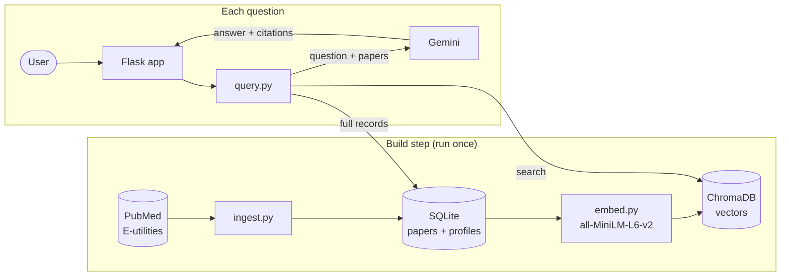
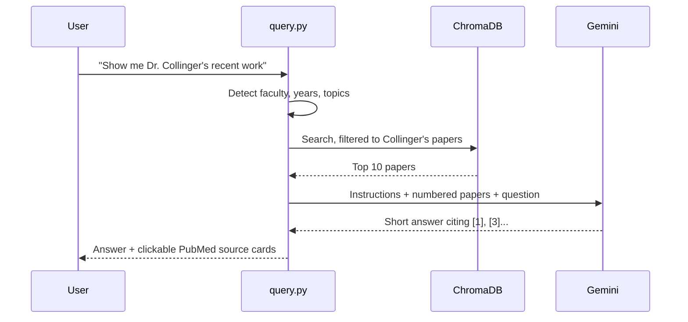

# PM&R Research Explorer

A chatbot that answers questions about research in the University of Pittsburgh's
**Department of Physical Medicine & Rehabilitation**. Answers come from the department's published
papers, and every answer links to its sources on PubMed.

> "Who works on brain-computer interfaces?" · "I'm interested in wheelchair technology. Who should I
> talk to?" · "Compare Dr. Boninger's and Dr. Cooper's research."

**27 faculty · 1,488 publications (1994–2026)**

<!-- Screenshots: save them as docs/images/answer.png and docs/images/profile.png, then remove these comment markers.
<p align="center">
  
  
</p>
-->

## How it works

Retrieval-augmented generation (RAG). Papers are indexed once. For each question, the most relevant
papers are retrieved and passed to an LLM, which writes an answer that cites them.



Request flow:



## Tech stack

| Layer | Tool |
|---|---|
| Data | PubMed via NCBI E-utilities |
| Embeddings | `all-MiniLM-L6-v2` (ONNX, runs locally on CPU) |
| Vector store | ChromaDB |
| LLM | Google Gemini, with fallback models (provider set by `LLM_PROVIDER`) |
| Backend | Python, Flask, SQLite |
| Frontend | HTML, CSS, JavaScript |
| Hosting | Render |

## Quick start

Requires Python 3.10+ and a [Gemini API key](https://aistudio.google.com/apikey).

```bash
git clone https://github.com/vishruthreddy18/pmr-research-bot.git
cd pmr-research-bot
echo "GOOGLE_API_KEY=your-key" > .env
./setup.sh              # installs dependencies, downloads papers, builds the index (~2 min)
source venv/bin/activate
python app.py           # http://localhost:5001
```

The prebuilt database is included. To run the app without rebuilding it, use
`pip install -r requirements.txt` instead of `setup.sh`.

## Project layout

```
├── app.py          Flask routes (chat, faculty, topics, stats)
├── query.py        RAG engine: query parsing → retrieval → LLM → citations
├── ingest.py       PubMed download → SQLite
├── embed.py        SQLite → ChromaDB embeddings
├── faculty.py      Faculty list and per-person PubMed search settings
├── config.py       All settings
├── templates/      Chat page
├── static/         CSS and JavaScript
├── data/           Prebuilt database and vector index
└── docs/DETAILS.md Retrieval rules, search tuning, configuration, API, deployment
```

## Limitations

- **Coverage:** papers come from PubMed only, matched by author name and affiliation. Some papers
  are missing, especially engineering conference papers and older co-authored work. See
  `data/ingest_report.txt`.
- **Answers are AI-generated** and can be wrong; check the linked sources.
- **Don't enter confidential or unpublished work.** Questions are sent to Google's Gemini API.

## Credits

- **Research:** the publications belong to the Pitt PM&R faculty, their co-authors and their
  publishers.
- **Data:** [PubMed](https://pubmed.ncbi.nlm.nih.gov/) and the
  [NCBI E-utilities API](https://www.ncbi.nlm.nih.gov/books/NBK25501/), from the U.S. National
  Library of Medicine. Abstracts remain the copyright of their publishers.
- **Embedding model:** [all-MiniLM-L6-v2](https://huggingface.co/sentence-transformers/all-MiniLM-L6-v2)
  by the sentence-transformers project ([Reimers & Gurevych, 2019](https://arxiv.org/abs/1908.10084)),
  built on Microsoft's MiniLM ([Wang et al., 2020](https://arxiv.org/abs/2002.10957)).
- **Libraries:** [ChromaDB](https://www.trychroma.com/), [ONNX Runtime](https://onnxruntime.ai/),
  [Flask](https://flask.palletsprojects.com/), [Gunicorn](https://gunicorn.org/) and the
  [Google Gen AI SDK](https://github.com/googleapis/python-genai).
- **LLM:** [Google Gemini](https://ai.google.dev/).

*This is an independent project and not an official University of Pittsburgh product. The Pitt name
and colors are trademarks of the University of Pittsburgh.*
